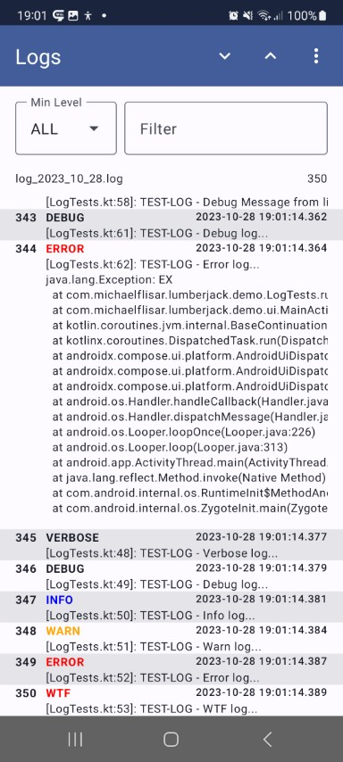
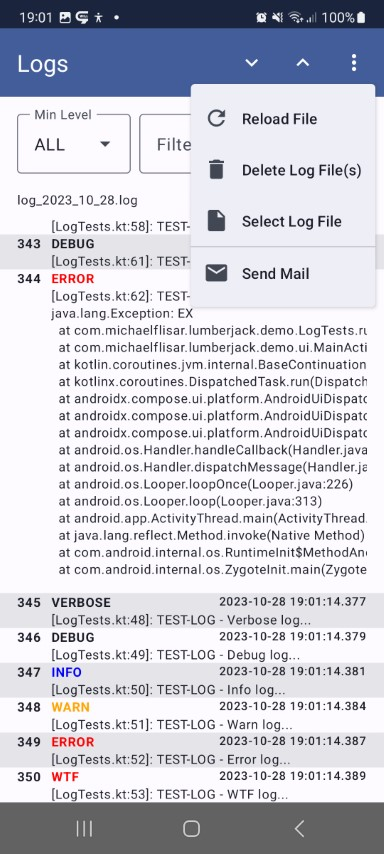
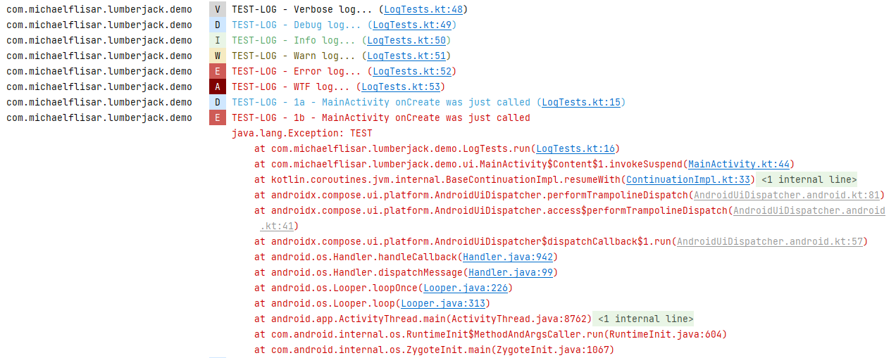
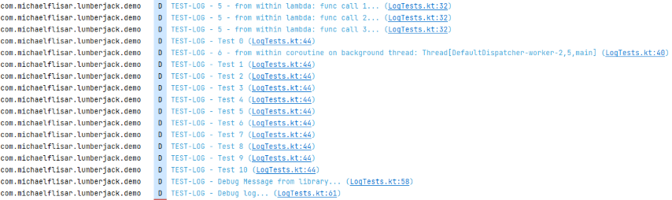

[](https://central.sonatype.com/artifact/io.github.mflisar.lumberjack/core)   
# Lumberjack
     

This library provides following main features:

* simply lazy evalution based logger based on a `L` class for the shortest possible log codes
* easily extendible with custom loggers
* offers console and file logger implementations
* supports log filtering
* providers a viewer for log files

# Table of Contents

- [Screenshots](#camera-screenshots)
- [Supported Platforms](#computer-supported-platforms)
- [Versions](#arrow_right-versions)
- [Setup](#wrench-setup)
- [Usage](#rocket-usage)
- [Modules](#file_folder-modules)
- [Demo](#sparkles-demo)
- [More](#information_source-more)
- [API](#books-api)
- [Other Libraries](#bulb-other-libraries)

# :camera: Screenshots

### composeviewer

|  |  |  |
|---|---|---|
|  |  |

### core

|  |  |  |
|---|---|---|
|  |  |

# :computer: Supported Platforms

| Module | android | iOS | windows | macOS | wasm | Notes |
|---|---|---|---|---|---|---|
| core | ✅ | ✅ | ✅ | ✅ | ✅ | the core module of lumberjack |
| logger-console | ✅ | ✅ | ✅ | ✅ | ✅ | a console logger for lumberjack |
| logger-file | ✅ | ✅ | ✅ | ✅ | ❌ | a file logger for lumberjack |
| extension-composeviewer | ✅ | ✅ | ✅ | ✅ | ✅ | a compose viewer for lumberjack |
| extension-feedback | ✅ | ✅ | ❌ | ❌ | ❌ | a feedback module for lumberjack |

# :arrow_right: Versions

| Dependency | Version |
|---|---|
| Kotlin | `2.4.0` |
| Jetbrains Compose | `1.11.1` |
| Jetbrains Compose Material3 | `1.9.0` |

> :warning: Following experimental annotations are used:
> - **OptIn**
>   - `androidx.compose.material3.ExperimentalMaterial3Api` (3x)
>   - `kotlinx.cinterop.ExperimentalForeignApi` (1x)
>
> I try to use as less experimental features as possible, but in this case the ones above are needed!

# :wrench: Setup

<details open>

<summary><b>Using Version Catalogs</b></summary>

<br>

Define the dependencies inside your **libs.versions.toml** file.

```toml
[versions]

lumberjack = "<LATEST-VERSION>"

[libraries]

lumberjack-core = { module = "io.github.mflisar.lumberjack:core", version.ref = "lumberjack" }
lumberjack-logger-console = { module = "io.github.mflisar.lumberjack:logger-console", version.ref = "lumberjack" }
lumberjack-logger-file = { module = "io.github.mflisar.lumberjack:logger-file", version.ref = "lumberjack" }
lumberjack-extension-composeviewer = { module = "io.github.mflisar.lumberjack:extension-composeviewer", version.ref = "lumberjack" }
lumberjack-extension-feedback = { module = "io.github.mflisar.lumberjack:extension-feedback", version.ref = "lumberjack" }
```

And then use the definitions in your projects **build.gradle.kts** file like following:

```java
implementation(libs.lumberjack.core)
implementation(libs.lumberjack.logger.console)
implementation(libs.lumberjack.logger.file)
implementation(libs.lumberjack.extension.composeviewer)
implementation(libs.lumberjack.extension.feedback)
```

</details>

<details>

<summary><b>Direct Dependency Notation</b></summary>

<br>

Simply add the dependencies inside your **build.gradle.kts** file.

```kotlin
val lumberjack = "<LATEST-VERSION>"

implementation("io.github.mflisar.lumberjack:core:${lumberjack}")
implementation("io.github.mflisar.lumberjack:logger-console:${lumberjack}")
implementation("io.github.mflisar.lumberjack:logger-file:${lumberjack}")
implementation("io.github.mflisar.lumberjack:extension-composeviewer:${lumberjack}")
implementation("io.github.mflisar.lumberjack:extension-feedback:${lumberjack}")
```

</details>

# :rocket: Usage

#### 1) Setup your loggers

```kotlin

// 1) register a console logger
L.plant(ConsoleLogger())

// 2) register a file logger
val setup = FileLoggerSetup.Daily(
    folder = FileLoggerSetup.getDefaultLogFolder(), // on android pass context; the setup simply expects a path to the folder in which the logs will be stored
)
L.plant(FileLogger(setup))

```
#### 2) Start logging

```kotlin

L.d { "Some log" }
L.e(Exception("TEST")) { "Some log with exception" }
L.logIf { false }?.d {
    // this block will never be executed thanks to lazy evaluation
    "this log will never be printed nor will this block ever be executed"
}

// examples with tags and types
L.tag("Custom Tag").v { "Verbose log..." }
L.tag("Custom Tag").d { "Debug log..." }
L.tag("Custom Tag").i { "Info log..." }
L.tag("Custom Tag").w { "Warn log..." }
L.tag("Custom Tag").e { "Error log..." }
L.tag("Custom Tag").wtf { "WTF log..." }

```

# :file_folder: Modules

- [Compose Viewer](documentation/Modules/Compose%20Viewer.md)
- [Feedback](documentation/Modules/Feedback.md)

# :sparkles: Demo

A full [demo](/demo) is included inside the demo module, it shows nearly every usage with working examples.

# :information_source: More

- Advanced
  - [Custom Logger](documentation/Advanced/Custom%20Logger.md)
- Migration
  - [Migration to version 10](documentation/Migration/v10.md)
  - [Migration to version 7](documentation/Migration/v7.md)

# :books: API

Check out the [API documentation](https://MFlisar.github.io/Lumberjack/).

# :bulb: Other Libraries

You can find more of my multiplatform libraries that work well together [here](https://mflisar.github.io/Libraries/).

# :twisted_rightwards_arrows: Compatibility

When combining my libraries, you can find compatibility information [here](https://mflisar.github.io/Libraries/compatibilities/).
